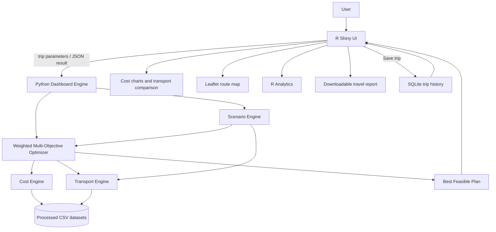

# Travel Cost Optimizer

## 1. Project Title

**TravelOptima — Travel Cost Optimizer**

## 2. Problem Statement

Planning a trip requires comparing transport, lodging, food, activities, and
local travel while keeping the combined cost within a budget. Route fares and
destination coverage are incomplete in the supplied datasets, so the project
distinguishes recorded prices from modeled estimates.

## 3. Objective

Provide an interactive decision-support dashboard that estimates a trip,
selects a feasible plan using cost, travel-time, and comfort scores, compares
transport and comfort scenarios, explores what-if changes, and retains saved
trip history.

## 4. Features

- R Shiny trip planner for origin, destination, travelers, days, budget,
  preference, and accommodation.
- Route planning for supported Indian and international city pairs, with an
  explicit INR estimate warning for international destinations.
- Python weighted multi-objective optimizer with budget feasibility filtering.
- Flight, train, bus, and car comparisons, with cost, time, distance, and
  budget status where available.
- Cost breakdown, Leaflet route map, and a written recommendation explaining
  the selected plan.
- The route map uses public OpenStreetMap tiles and does not require a map API
  key.
- Independent what-if recalculation and Budget/Balanced/Comfort/Luxury
  scenario detail.
- R Analytics tab for flight-price distribution, airline comparison, hotel
  prices by city, food prices, and fuel-price trend.
- Downloadable plain-text travel report.
- SQLite trip history: save optimized trips, list recent trips, and display
  saved trip summaries in the dashboard.

## 5. System Architecture



## 6. Dataset Information

Processed inputs used by the application:

| Data | File | Role |
|---|---|---|
| Flights | `data/processed/flights.csv` | Route-matched flight prices where available |
| Hotels | `data/processed/hotels.csv` | City hotel prices and hotel analytics |
| Tourism | `data/processed/tourism.csv` | Destination cost ranges, activities, and local travel estimates |
| Food | `data/processed/food.csv` | Restaurant item prices; city-matched fallback when tourism destination costs are unavailable |
| Fuel | `data/processed/fuel_prices.csv` | Latest available route-city petrol prices for car estimates and fuel analytics |

The files are locally supplied project datasets. Keep their source and license
information with the original downloads; dataset licensing is not inferred by
this application.

### Recorded data versus estimates

- **Flight:** price is taken from the flight dataset for a matching source and
  destination; when route duration values are present, their median is used as
  the estimated flight time. Without a matching route, flight cost and time
  are distance-based estimates.
- **Hotel:** tourism daily accommodation ranges are used for tourism-covered
  destinations. For destinations without a tourism record, the fallback uses
  the city-matched hotel dataset mean when available.
- **Food:** tourism daily food ranges are used for tourism-covered
  destinations. The fallback for uncovered cities uses the city-matched
  restaurant item-price median multiplied by three as a rough daily meal
  allowance per traveler.
- **Activities and local transport:** tourism ranges are used where present;
  uncovered cities use tourism-dataset medians as a fallback estimate.
- **Train and bus:** fares are estimated from Haversine straight-line distance
  using ₹0.75/km and ₹1.25/km per traveler respectively. They are not quoted
  route fares. These modes are only offered when both cities are in the same
  country.
- **Car:** fuel required is estimated as distance / 15 km/L. Fuel cost uses
  the latest available petrol record for either endpoint city; if neither
  endpoint is represented, the latest national dataset median is used. Tolls
  are estimated at ₹0.75/km. Distance is a straight-line proxy, not road
  routing.
- **Contingency:** 10% of modeled subtotal.
- Monetary components and contingency are rounded to paise before the reported
  total is summed, so the displayed component amounts add exactly to the total.
- **Transport comparison:** each mode shows its fare plus a complete-trip
  estimate using the same lodging, food, activities, and local-transport
  assumptions as the selected plan. In a no-feasible-plan result, the
  comparison uses the requested accommodation level, or Budget accommodation
  when accommodation is automatic.
- **Scenarios:** Budget, Balanced, Comfort, and Luxury use the same selected
  transport mode and fare, so scenario totals differ because of their
  accommodation and comfort assumptions rather than silently switching to
  flight-only pricing. If no feasible plan exists, the lowest-fare available
  transport is used as the scenario reference and is identified in the table.

All non-recorded route costs, distances, times, and fallbacks are planning
estimates, not live prices, bookings, or navigation directions.

Supported international cities include Dubai, Abu Dhabi, Doha, Singapore,
Kuala Lumpur, Bangkok, Tokyo, Seoul, Hong Kong, London, Paris, Amsterdam,
Berlin, Rome, Madrid, Zurich, Cairo, Nairobi, New York, Los Angeles, Toronto,
Mexico City, Rio de Janeiro, Sydney, Melbourne, Auckland, Colombo, Kathmandu,
Dhaka, Male, and Thimphu. For non-India destinations, hotel, food, activity,
and local-transport totals are based on Indian dataset benchmarks because
destination-country cost data is not bundled with this project; they must not
be treated as local-price quotes.

## 7. Technologies Used

- R and R Shiny for the dashboard and statistical visualizations.
- Python and pandas for dataset-backed cost and optimization logic.
- SQLite (Python standard-library `sqlite3`) for trip history.
- Leaflet for the route map.
- ggplot2 for R charts.
- CSV datasets supplied with the project.

NumPy and Matplotlib are not directly called by the current application code;
the implementation uses pandas and ggplot2 for its current analysis.

## 8. Algorithms

- **Weighted multi-objective optimization:** transport alternatives are scored
  using cost, travel-time, and comfort components. Preference selects their
  weights: Budget (0.70/0.20/0.10), Balanced (0.50/0.30/0.20), Comfort
  (0.30/0.40/0.30), and Luxury (0.20/0.40/0.40).
- **Constraint satisfaction:** only plans within the entered budget are
  considered feasible by the optimizer.
- **Haversine distance:** estimates great-circle distance between known city
  coordinates.
- **Cost estimation:** dataset values are used where coverage exists; explicit
  rules provide missing-route or missing-city estimates.
- **What-if analysis:** reruns the optimizer with alternative trip parameters.
- **Statistical analysis:** summarizes and plots the available flight, hotel,
  food, and fuel datasets.

## 9. Folder Structure

```text
Travel-Cost-Optimizer/
├── app/                 # Shiny UI, server, and entry point
├── R/                   # R analysis and visualization modules
├── python/              # Cost, transport, optimization, scenario, and history engines
├── data/
│   ├── raw/              # Original category-organized datasets
│   └── processed/        # CSVs consumed by the application
├── database/
│   └── travel_optimizer.db
├── docs/
│   └── architecture.mmd
├── reports/
├── config/
├── requirements.txt
└── README.md
```

The standalone diagram is available at [`docs/architecture.mmd`](docs/architecture.mmd).

## 10. Installation

1. Install R and Python 3.
2. Install the R packages `shiny`, `jsonlite`, `leaflet`, and `ggplot2`.
3. Create/activate the project Python virtual environment and install the
   dependencies from `requirements.txt`.
4. Ensure the processed CSV files listed above are present.

The Shiny app resolves its Python scripts and analytics datasets relative to
the project directory, so the project can be moved without editing path
constants.

Install the Python requirement with:

```powershell
.\.venv\Scripts\python.exe -m pip install -r requirements.txt
```

## 11. How to Run

From R/RStudio, set the working directory to the project root, then start the
app directory (do not `source()` `app.R` directly):

```r
setwd("D:/R_programming.R/Travel-Cost-Optimizer")
shiny::runApp("app")
```

Alternatively, run `shiny::runApp("D:/R_programming.R/Travel-Cost-Optimizer/app")`
using the actual path where you placed the project.

The app starts with a Chennai-to-Goa sample trip. Optimize a trip, use the
what-if controls to compare changed assumptions, choose **Save Current Trip**
to add a feasible result to SQLite history, or download a plain-text report.
Open the **Analytics** tab for dataset charts.

The Python engine can also be tested directly:

```powershell
.\.venv\Scripts\python.exe python\dashboard_engine.py `
  --origin Chennai --destination Goa --days 5 --travelers 2 `
  --budget 25000 --preference balanced
```

## 12. Sample Output

For Chennai → Goa, 2 travelers, 5 days, ₹25,000, Balanced preference, the
current optimizer returns:

```text
Transport: Train
Transport Cost: ₹1,116.05
Hotel: ₹4,000.00
Food: ₹3,000.00
Activities: ₹2,000.00
Local Transport: ₹1,000.00
Contingency: ₹1,111.61
Total: ₹12,227.66
Cost per person: ₹6,113.83
Remaining budget: ₹12,772.34
Optimization score: 0.7343
Budget status: Within Budget
```

The transport comparison's car estimate uses the fuel dataset; changing that
estimate can affect transport scores. Verify the output against the current
dataset before using this illustrative sample in a report.

## 13. Limitations

- The flight data may not contain every route and may not represent current
  bookable fares.
- Train and bus fares, vehicle mileage, toll charges, local estimates, and
  Haversine route distances are approximations.
- Fuel prices are historical dataset observations, not a live price feed.
- Restaurant item median × three is a rough fallback meal allowance, not a
  complete meal plan.
- The route map connects city coordinates directly and is not a road route.
- City-level fallback estimates should be treated cautiously where city data is
  missing and a broader dataset median is used.

## 14. Future Enhancements

- Use route-wise train/bus fares and a road-routing distance provider.
- Connect live flight, lodging, traffic, and fuel-price services.
- Add user accounts, trip deletion/export, and richer history filtering.
- Add automated tests for dataset schema and model calibration.
- Make project paths configurable for portable installation.
